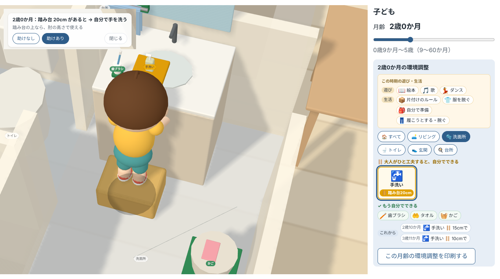
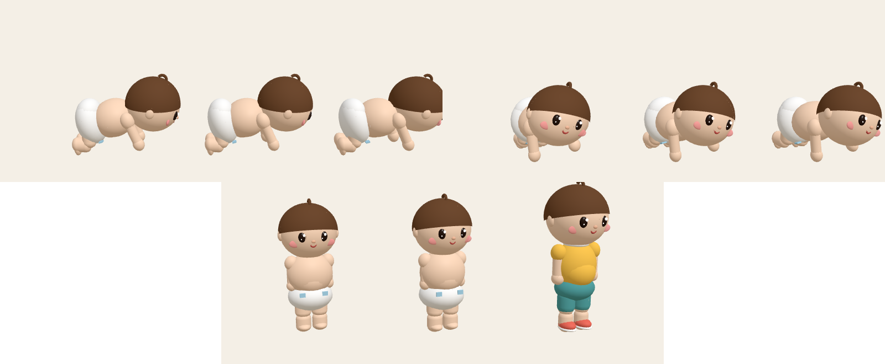
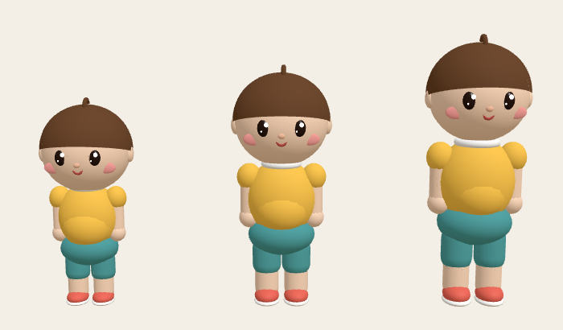

# あーちゃんが やる！ — Growing Reach

**「大人がこの助けをしてくれたら、あーちゃんは自分でできる」**

2〜3歳の子は、自分を名前で呼んで「あーちゃんが やる！」と言います。この作品は、その「やりたい」に大人が環境で応えるための道具です。画面で家の中を歩き回る子が、あーちゃんです（男の子にも女の子にも読める名前にしました。計算は一般的な子の体の値です）。

0歳9か月〜5歳の子どもの体（身長・手が届く高さ・登れる高さ・肘の高さ）を公的調査と研究の値から計算し、家の中で「いま自分でできること」「踏み台などの助けがあればできること」「まだのこと」を、3D の家の中で見せるツールです。

- デモ: https://mindplottech.github.io/growing-reach/ （PC ブラウザ、幅 1280px 以上）
- デモ動画（3分）: （提出時に追記）
- 提出用の概要（英語・日本語）: [docs/submission.md](docs/submission.md)
- Built with Claude Japan 2026 — テーマ1「あなたにしかない深さを。」



> English summary: "あーちゃんが やる!" ("Let me do it!", in a toddler's voice) / Growing Reach computes what a 15–60-month-old child can reach and climb at home, using only values from Japanese public surveys and published studies, and shows in 3D which small changes by an adult (a step stool of a given height, a lower shelf, moving a cup closer to the edge) let the child do things by themselves. No AI or API is used inside the app; no input leaves the browser.

---

## なぜ作ったか

子どもは、体が追いつく前から「自分でやる！」と言います。高いところの絵本を自分で取りたい。食器棚の自分のコップを自分で出したい。やりたいのにできない、は、子どもが悪いのではなく、家が大人の体に合わせて作られているからです。

環境を変えれば解決できることが多いのですが、どこをどう変えればよいかは言葉では伝わりにくい。発達は見えませんが、環境は見えます。だから、見えるようにしました。

数字の上では1歳でも踏み台に乗ればスイッチに届きますが、1歳の足元はふらふらです。だからこの作品は踏み台を出さず「抱っこで」とします。大人も環境です。月齢はスライダーで、「何歳でできる」ではなく順序の見通しとして見せます。

## 何ができるか

- **月齢スライダー（9〜60か月）**: 一般的な子（身長の中央値）の体で、家の中のやりたいことを分けます。右の欄はアイコンのタイルで、色と短いバッジ（✓自分で／🪜踏み台15cm／🤗抱っこで）でひと目でわかります。
- **年ごろの遊びと生活（現場の判断）**: 作者が挙げた年ごろごとの遊びと生活（いないいないばあ、手遊び、片付けのルール、しりとり、鬼ごっこ…）をアイコンで出し、やりたいことも年ごろで入れ替わります。
- **つかまり立ちのころ（9か月〜1歳4か月）**: はいはいで動き、家具につかまって立って手を伸ばします。はいはい期に登れる高さの実測がないので、登る計算はしません。


  - 自分でできる
  - この助けがあればできる（踏み台 ○cm／段を下げる／縁に寄せる）
  - 大人と一緒に（大人が抱っこして）
  - まだ
- **現場の判断を入れる**: 体の寸法だけなら、1歳3か月でも「踏み台35cm に乗ればスイッチに届く」と出ます（登れる高さは約40cm）。でも発達支援の現場では、1歳代から2歳半ごろまでは、大人が付き添っても踏み台には乗せません。抱っこして一緒にします。この作者の判断を台帳に「作者（発達支援の実務）の判断」として入れ、踏み台は2歳半（手洗いは2歳）から「踏み台○cm（最初は付き添って）」、それまでは「大人と一緒に（大人が抱っこして）」と出します。電気のスイッチは踏み台で押させず、床から届くまで大人と一緒に。調理台はずっと大人と一緒に。**体の数字は公的調査から、それをどう使うかは現場から**、という分け方です。
- **助けを置いて見せる**: 「この助けがあればできる」の行を押すと、3D でその場所へカメラが寄り、踏み台を置いてあーちゃんがその上に立って手を伸ばします。「助けなし／助けあり」を切り替えられます。スライダーを動かすと、同じ枠の中であーちゃんの背が伸び、踏み台が低くなります（例：手洗い＝2歳になるまでは大人が抱っこして → 2歳から踏み台20cm（最初は付き添って）→ 2歳10か月 15cm → 3歳11か月 10cm）。
- **あーちゃん**: 家の中を歩き回る子は、計算に使っている子そのもの（台帳の中央値の身長と登れる高さ）です。月齢で背が伸び、頭の比率が小さくなります。つかまり立ちのころはおむつ姿で、膝をついた四つ這いのはいはい（右手と左膝が一緒に出る）、1歳台はよちよち歩きで腕を広げて歩きます。見ている人の方へ顔を向けます（見た目はすべて表示だけで、計算には入りません）。
- **1つの家の5つの部屋**: リビング・洗面所・トイレ・玄関・台所。手を洗う・調理台で手伝うといった手を使う作業は、指先が届くかではなく、天板が肘の高さに近いかで判定します。
- **次に変わること**: この先、どの助けが何 cm で足りるようになり、いつ要らなくなるか。
- **だから大人がすること**: 置いた踏み台から薬・はさみ・コード・窓の錠に届くなら「○cm より上へ」と出します。

### 「できる」の意味

「できる」は **届く・登れる・肘の高さで使える** という体の事実だけです。上手にできるか、やる気があるか、意味がわかっているかは扱いません。また、表示は**順序の見通し**であり、「○か月になったらできる」という時期の予言ではありません。

## 根拠の扱い

このツールで一番気をつけたのは、**数字がどこから来たかを隠さないこと**です。

- 体の値はすべて `data/values_ledger.json`（値の台帳）にあり、コードに数値を直接書いていません。台帳には出典（著者・年・題名・発行元・表とページ）と、原典どうしが食い違ったときに何を採用したか（決定の記録）が入っています。
- 値は4つに区分しています。区分は台帳に従い、計算の途中でより確かな区分へ**格上げしません**。
  - **根拠あり（実測）** — 例: 身長の P3〜P97（こども家庭庁 2024「令和5年乳幼児身体発育調査」表2）
  - **根拠あり（推定式）** — 例: 立って手が届く高さ＝身長×1.59−34.22（持丸ほか 2013、消費者安全調査委員会 2025 経由）、登れる高さ＝0.9842×月齢＋25.132（東京都 2024、15〜45か月）
  - **要換算** — 原典の値から計算したもの。例: 身長の SD＝(P97−P3)÷3.762
  - **仮値** — 根拠となる実測がない設計者の判断。例: つま先立ちで伸びる分（+5〜10cm）、部屋の配置
- 台帳にない値はすべて `sim/params.js` に集め、区分と決め方を付けています。
- 画面ヘッダーの「根拠を見る」で、台帳と仮値の一覧をそのまま表示します。
- 下限は9か月です。身長はこども家庭庁 2024 表2 に月ごとにあり、立って届く高さの式は消費者安全調査委員会 2025 表4 が9か月から当てています。9か月より前は届く高さを計算できる根拠がなく、はいはいの速さ・はいはい期に登れる高さも実測が見つからなかったため、はいはいの速さは仮値、登る計算はしていません。

主な出典（全一覧は台帳の `_meta.sources`）:

- こども家庭庁（2024）「令和5年乳幼児身体発育調査 調査結果の概要」
- 消費者安全調査委員会（2025）『住宅の窓及びベランダからの子どもの転落事故』
- 東京都（2024）『令和5年度セーフティ・レビュー事業 報告書』
- 持丸ほか編（2013）『子ども計測ハンドブック』朝倉書店
- Rygelová M ほか（2023）PLoS ONE 18(5): e0285558（歩く速さ・歩幅）
- 国土技術政策総合研究所（2025）『子育てに配慮した住宅と居住環境に関するガイドライン（改訂版）』
- 国土交通省「高齢者が居住する住宅の設計に係る指針」、TOTO 工事寸法図ほか（設備の高さ）

## 使った人の声

作者の友人3人（子育て中・子育てを終えた人）に見てもらいました。

- 赤ちゃんのころから、どんなことができるようになっていくかが見られる。
- 自分の子どもが歩いたときを思い出す。かわいい。
- 初めて子どもを持ったとき、家の中での子どもの育ちのイメージができていい。
- 根拠が示されていて安心。

## 入力とプライバシー

- 入力は月齢のスライダーだけです。名前・身長・体重・自由記入・発達検査の結果は聞きません（以前あった「うちの子に合わせる」の身長入力は、月齢だけで足りるという作者の判断で外しました）。
- 計算はすべてブラウザの中で行い、サーバー・API に送りません。URL にも載せず、保存（localStorage など）もしません。
- 作品の中では AI・API を使っていません。安全の助言や説明文を生成せず、画面の文は計算結果から決まった形で組み立てています。

## Claude Code の使い方

このリポジトリのコードはすべてハッカソン期間中（2026-11-03〜）に Claude Code と作りました（ハッカソン前の試作のコードは使っていません）。作り始めは 11/3（文化の日）の早朝で、コミットは Claude Code が作業の区切りごとに自分で行ったため、数秒おきに並んでいるところがあります（各コミットに `Co-Authored-By: Claude` の行があります）。発達支援の現場の判断は人（KO）が、原典の読み込み・実装・確かめは Claude Code が受け持ち、**Claude Code が決まりを破れない仕組み**を repo に置いています。

### 1. 原典をページまで当たって台帳を作る

体の値はすべて、Claude（調査）と Claude Code が原典（PDF・論文）を開いて、表番号とページまで確かめて台帳に入れました（例：こども家庭庁 2024 表2 p.2、東京都 2024 p.98 の式と n=27、消費者安全調査委員会 2025 表4 p.10）。原典どうしが食い違うところは候補と理由を並べ、KO が決めて `_meta.decisions` に残しています（例：4〜5歳の登れる高さ）。二次引用や未確認の値は「仮値」とし、確かな区分に**格上げしない**決まりです。手順は skill（`.claude/skills/ledger-update`）にしています。

### 2. 決まりを仕組みで守らせる（hooks と検証）

- `scripts/check-ledger.mjs`（`npm run check:ledger`）：すべての値に4区分がある／仮値以外は登録された出典を指す／二次引用・未確認の値が根拠ありになっていない／台帳の式の係数（1.59・0.9842 など15個）がコードに数字で書かれていない、を確かめます。
- `.claude/settings.json` の hooks：Claude Code が `git commit` しようとすると、先に `npm test`（270件）と台帳の検証が走り、通らなければ**コミットが止まって理由が Claude に返ります**。台帳やコードを書き換えた直後にも台帳を検証します。

```
コミットを止めました（.claude/hooks/pre-commit-check.mjs）。通らなかった確認：npm test・台帳の検証
- sim/zz_demo_bad.js:1: 台帳の式の係数 1.59 がコードに直接書かれている（台帳から読む）
```

### 3. 3D を自分で描いて、画像を見て直す

テストは計算しか確かめません。`scripts/render-check.sh` は three.js を取得して headless Chrome で 3D を実際に描き、画像に保存します。Claude Code はその画像を読んで見た目を確かめます（skill：`.claude/skills/render-check`）。これで見つけて直したもの：

- あーちゃんの背が台帳の身長より 7.5% 低く描かれていた
- 1歳台の「腕を構える」歩き方が、胸の前で腕を組む向きになっていた
- 近い画面ではカメラも一緒に下がり、月齢を上げても育って見えなかった
- 家の中を歩く子が中央値の子ではなく、右の欄の数字と別の子になっていた（身長の帯が 50cm・92cm、台帳の中央値は 39.9・86.5）



### 4. 人と AI の分担を毎回記録する

`docs/dev-log.md` に、機能ごとに「Claude Code に任せたこと／私（KO）の判断」を残しています（skill：`.claude/skills/dev-log-entry`）。取り消した決定も理由とともに残しています。いちばん大きいのは、画面の主役を「100人のうち何%が危険な物に届くか」から「この助けで自分でできること」へ変えた 11/5 の決定です（KO の仕事である発達支援の環境調整につながって見えなかったため）。

- **Claude Code に任せたこと**: 原典の読み込みと台帳、計算（`sim/`）と表示（`render/`）、テスト、仮値の候補と理由、描画しての確認、不具合の原因調査。
- **作者（KO）が決めたこと**: 現場の判断（2歳半までは踏み台に乗せず抱っこで、その後は付き添いから）、作品の向き、原典が食い違うときに採る値、仮値の選択、月齢の範囲、入力項目とプライバシー、画面に何を出し何を出さないか、あーちゃんという名前。

### 5. Claude に別の役を任せる

作っている Claude とは別の Claude に、作業の経緯を知らせずに役を任せ、作り手の思い込みを外から崩しました。

- **審査役**：審査基準（デモ・インパクト・Claude の使い方・深さ）で辛口に採点させた。「作者にしかない深さが画面に見えない」「1歳3か月に踏み台35cm には専門家から異論が出る」という指摘から、作者の現場の判断（2歳半までは抱っこ、手洗いは2歳から）を台帳に入れる、という一番大きな改善が生まれた。
- **調査役**：9か月まで広げるために、乳児の身長・運動発達・はいはいの速さ・つかまり立ちで届く高さを原典で当たらせた。見つかったもの（こども家庭庁 2024 表2、消費者安全調査委員会 2025 表4）だけを根拠にし、見つからなかったもの（はいはいの速さ、はいはい期に登れる高さ）は仮値・計算しない、と分けた。
- **ブラウザでの動作確認**：Claude in Chrome に、月齢ごとの点検（不自然な助けがないか）・部屋・助けの場面を実際に操作させる（プロンプトは `docs/browser-test-prompt.md`）。

## 動かし方

```sh
npm start                     # http://localhost:8080 （fetch を使うので file:// では動きません）
npm test                      # node --test（依存なし）
npm run check:ledger          # 台帳の検証
bash scripts/render-check.sh  # 3D を描いて .cache/shots/ に保存（Chrome が要る）
```

ビルドはありません。表示だけ Three.js を CDN から ES Modules で読み込み、計算部分（`sim/`）は依存なしでブラウザと Node の両方で動きます。

## 構成

| 場所 | 中身 |
|---|---|
| `data/values_ledger.json` | 値の台帳（出典・区分・決定の記録） |
| `data/room_layout.json` | 家の配置（設計者が置いた仮値。高さは台帳を指す） |
| `sim/` | 計算（体・届く・登れる・環境調整・助けの場面・家の中を歩く動き）。DOM も Three.js も使わない |
| `render/` | 表示（右の欄、3D の家・子ども・物の形） |
| `test/` | `node --test` のテスト（270件） |
| `scripts/` | 台帳の検証、3D を描いて確かめるスクリプトと図形の確認ページ |
| `.claude/` | Claude Code の hooks（コミット前の確認）と skills（手順書） |
| `docs/dev-log.md` | 開発ログ（AI に任せたことと人が判断したこと） |
| `assets/icons/` | Lucide のアイコン（ライセンスは同じフォルダの LICENSE） |

## 限界

- 画面から外した試作の跡（100人の試行・危険な物の判定と再生・家具の編集）は、コード（`sim/`・`render/`）とテストに残っています。主役を自立支援に変えたときに隠したもので、今の画面からは使っていません。

- 部屋の配置と家具の位置は仮値です。家の実際の寸法を入れる機能はありません。
- 立って手が届く高さの式は、元データの年齢範囲を原典で確認できていません。
- 4〜5歳の登れる高さ、1歳台の歩く速さなど、換算や延長に頼っている値があります（台帳に区分つきで明記）。
- はいはいの速さと、はいはいの姿の角度は仮値です（実測が見つからない）。
- 対象は PC ブラウザのみです。

## ライセンス

MIT License（`LICENSE`）。アイコンは Lucide（ISC、`assets/icons/LICENSE`）。台帳の値は各出典に由来し、出典は台帳の `_meta.sources` にあります。
